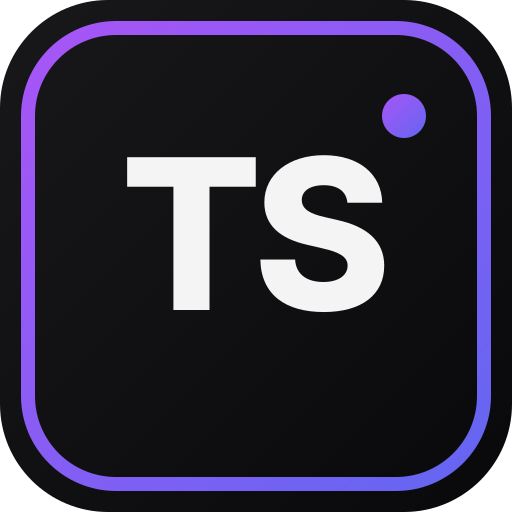

  

<h1 align="center">TavernSmith</h1>

  <strong>The Complete SillyTavern V2 &amp; V3 Character Card &amp; Lorebook Studio</strong>

  
  
  
  

---

**TavernSmith** is a standalone, privacy-first Character Card (`chara_card_v2` & `chara_card_v3`) and World Info (Lorebook) studio built for SillyTavern creators, roleplayers, and worldbuilders. Craft rich characters, embed metadata directly into portrait PNGs, build interactive RPG stat-blocks, and connect to your favorite local or cloud AI models—all with zero telemetry and zero administrator privileges required.

---

## 📥 How to Download & Launch

1. Go to the [**Releases**](../../releases) tab on the right side of this repository.
2. Under **Assets** on the latest release, download **`TavernSmith-App-Portable.zip`**.
   > ⚠️ **Important:** Download **`TavernSmith-App-Portable.zip`**—do **not** download GitHub's default `Source code (zip)` or `Source code (tar.gz)` archives.
3. Extract `TavernSmith-App-Portable.zip` to any folder on your computer.
4. Launch the app:
   - **Windows:** Double-click **`Launch-TavernSmith-Windows.bat`** (runs cleanly as a standard user—no Administrator privileges required).
   - **macOS (Intel & Apple Silicon) / Linux:** Double-click **`Launch-TavernSmith-Mac-Linux.command`** (or run `./Launch-TavernSmith-Mac-Linux.command` in Terminal).
   - **Desktop / Mobile App Mode (PWA):** Once open in Chrome, Edge, Brave, or Safari, click **Install App** in the top bar (or **Add to Home Screen** on iOS/Android) to run TavernSmith in its own dedicated app window offline.

---

## ✨ Core Features

### 🎭 SillyTavern V2 & V3 Character & Lorebook Studio
- **Dual Workflow Modes:** Switch anytime between the **Full Sandbox Workbench** (all fields, token meters, and tools side-by-side) and the guided **5-Step Creation Wizard** for both Characters and Lorebooks.
- **1-Click Concept-to-Character & Multi-Entry World Generator:** Turn a brief character premise or world concept into a complete SillyTavern card or multi-entry Lorebook with automatic trigger keys and token budgeting.
- **Draggable Alternate Greetings & Lorebook Entries:** Create, reorder, and AI-draft unlimited alternate greetings (`alternate_greetings`) and keyword/constant World Info entries.
- **Unified Local Save Folder:** Organize all your work automatically inside a single Root Save Folder with `Characters/` and `Lorebooks/` subfolders—either inside browser storage or synced directly to a real folder on your hard drive.

### 🖼️ PNG Portrait Steganography & Interactive `2:3` Cropper
- **Direct `.PNG` & `.JSON` Drag-and-Drop:** Drag and drop existing SillyTavern `.png` Character Cards, `.json` files, or raw portrait artwork directly onto the workspace to import and inspect them instantly.
- **Interactive `2:3` Portrait Cropper:** Automatically detects non-standard image dimensions and opens a pan-and-zoom canvas cropper with rule-of-thirds guides, exporting crisp **`512×768`** (HD) or **`400×600`** (Classic) SillyTavern portraits.
- **Pure Client-Side PNG Chunk Engine:** Embeds and extracts `chara` (V2) and `ccv3` (V3) `tEXt` chunks directly inside your browser—your API keys and personal settings are never written into exported cards.

### 🎲 Modular DM / GM Stat-Block Builder
- **Visual RPG & Relationship Trackers:** Build custom HUD trackers using visual progress bars (`[████░░]`), numeric counters, status strings, and inventory/condition lists.
- **Per-Stat AI Progression Rules:** Generate or customize turn-by-turn update rules for each stat (e.g., Affection, Corruption, Sanity, HP, Mana, Gold).
- **1-Click Card Compiler:** Automatically compiles your stat-block formatting instructions into `post_history_instructions` (UJB) and injects the initial rendered HUD into your character's `first_mes`.

### ✍️ SmartEditor with Inline AI Ghost-Text & Local `{{macro}}` Autocomplete
- **Real-Time SillyTavern Macro Highlighting:** Highlights `{{char}}`, `{{user}}`, `{{random:...}}`, `{{roll:...}}`, `{{time}}`, `{{date}}`, `{{weekday}}`, and `{{idle_duration}}` directly inside every text editor.
- **Instant `{{` Autocomplete Menu:** Type `{{` in any field to open a fast, keyboard-navigable macro picker with descriptions.
- **Inline AI Ghost-Text & Per-Field Toolbar:** Pause typing to preview subtle inline AI continuations (`Tab` to accept, `Esc` to dismiss), or use 1-click **Generate**, **Expand**, **Rewrite**, and **Polish Prose** buttons on any field.

### 🏷️ 84+ Built-In Tags, Hierarchical Sub-Tags, NSFW Toggle & Context Themes
- **Rich Genre, Trope & Anatomy Tag Library:** Attach tags and specialized **Sub-Tags** (e.g., *Big Breasts* → *Huge / Hyper*, *Perky*, *Natural Sag*; *Bondage* → *Shibari Rope*, *Cuffs & Chains*; *Monster Girl* → *Succubus*, *Slime Girl*, *Arachne*) that automatically guide AI prose generation.
- **🔞 1-Click "Hide NSFW Tags" UI Toggle:** Keep adult and fetish tags hidden from on-screen menus whenever you want a clean workspace—while still preserving 100% of attached NSFW tags and sub-tags in background AI generation prompts.
- **Dual-Layer Context Themes:** Switch between **Dark Mode** and **Light Mode** while selecting custom **Context Themes** in the top bar that simultaneously recolor the studio's accent highlights and set global AI writing style instructions.

### 🤖 Local & Cloud AI Backends (With Automatic Model Formatting)
- **Connect Local or Cloud Providers:** Built-in presets for **LM Studio**, **Ollama**, **KoboldCPP**, **Google Gemini**, **xAI Grok**, **Meta Llama**, **OpenRouter**, **Groq**, **OpenAI**, **Anthropic Claude**, and custom OpenAI-compatible endpoints.
- **Persistent Per-Provider Key Vault:** API keys and last-used models are remembered per provider so you can switch between local and cloud backends without ever retyping a key.
- **Model-Based Auto-Formatting & Gemma 4 Support:** Automatically detects the active model family (**Gemma 4 / 3 / 2**, **DeepSeek R1 / Qwen QwQ**, **Llama 3 / 4**, **Mistral / Mixtral / Pixtral**, **Grok**, **Gemini**, **Claude**), formats system prompts for strict local templates (including LM Studio + Gemma 4), and cleanly strips `<think>` and `<|thought|>` blocks into a collapsible Reasoning drawer.
