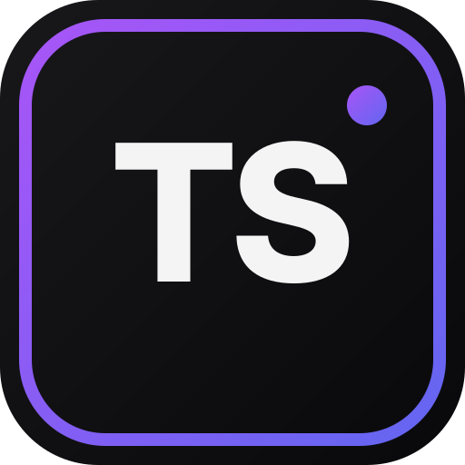

  

<h1 align="center">TavernSmith</h1>

  <strong>The Complete SillyTavern V2 &amp; V3 Character Card &amp; Lorebook Studio</strong>

  
  
  
  
  

---

**TavernSmith** is a native, privacy-first Character Card (`chara_card_v2` & `chara_card_v3`) and World Info (Lorebook) desktop studio built for SillyTavern creators, roleplayers, and worldbuilders. Craft rich characters, embed metadata directly into portrait PNGs, build interactive RPG stat-blocks, and connect to your favorite local or cloud AI models—with **zero terminal/CMD window**, zero telemetry, and zero administrator privileges required.

---

## 📥 How to Download & Launch

1. Go to the [**Releases**](../../releases) tab on the right side of this repository.
2. Under **Assets** on the latest release, download the `.zip` archive labeled for your operating system:
   > ⚠️ **Important:** Download one of the OS `.zip` archives below—do **not** download GitHub's default `Source code (zip)` or `Source code (tar.gz)` archives.

| Operating System | Download Archive | How to Launch | Active Save Folder |
| :--- | :--- | :--- | :--- |
| **Windows (x64)** | **`TavernSmith-Windows-x64-Portable.zip`** | Extract anywhere and double-click **`TavernSmith.exe`** (portable, no installer, no CMD window). | `./Saves/` next to `TavernSmith.exe` |
| **macOS (Apple Silicon & Intel)** | **`TavernSmith-macOS-Universal-DMG.zip`** | Open **`TavernSmith.dmg`**, drag `TavernSmith.app` to Applications, and launch (if Gatekeeper warns on first launch, right-click → **Open**). | `~/Library/Application Support/TavernSmith/Saves/` |
| **Linux (x64)** | **`TavernSmith-Linux-x64-AppImage.zip`** | Extract, run `chmod +x TavernSmith.AppImage`, and launch `./TavernSmith.AppImage` (or `APPIMAGE_EXTRACT_AND_RUN=1 ./TavernSmith.AppImage` without FUSE 2). | `./Saves/` next to `TavernSmith.AppImage` (falls back to `~/.local/share/TavernSmith/Saves/` if read-only) |

3. Click **Open Folder** inside **Options** at any time to reveal your active Saves folder in Explorer, Finder, or your Linux file manager.

---

## ✨ Core Features

### 🎭 SillyTavern V2 & V3 Character & Lorebook Studio
- **Dual Workflow Modes:** Switch anytime between the **Full Sandbox Workbench** (all fields, token meters, and tools side-by-side) and the guided **5-Step Creation Wizard** for both Characters and Lorebooks.
- **1-Click Concept-to-Character & Multi-Entry World Generator:** Turn a brief character premise or world concept into a complete SillyTavern card or multi-entry Lorebook with automatic trigger keys and token budgeting.
- **ID-Synced Character ↔ Lorebook Linking:** Link any Lorebook to a Character by ID so edits stay live—linked lorebooks are automatically injected into AI character generation context, embedded directly into exported `.png` and `.json` character cards, and auto-imported back into your Lorebooks library when importing cards with an embedded `character_book`.
- **Single Portable Save Folder & Strict Backups:** Organizes all workspace files cleanly inside one Saves root (`Characters/`, `Lorebooks/`, `Themes/`, and `Tags/`). Workspace backup exports and imports strictly include **Characters, Lorebooks, Themes, and Tags**—never app settings, AI backend configs, or API keys.

### 🖼️ PNG Portrait Steganography, Native Save Dialogs & `2:3` Cropper
- **Direct `.PNG` & `.JSON` Drag-and-Drop:** Drag and drop existing SillyTavern `.png` Character Cards, `.json` files, or raw raster portrait artwork directly onto the workspace to import and inspect them instantly (SVG and unsafe script URIs are strictly blocked).
- **Interactive `2:3` Portrait Cropper:** Automatically detects non-standard image dimensions and opens a pan-and-zoom canvas cropper with rule-of-thirds guides, exporting crisp **`512×768`** (HD) or **`400×600`** (Classic) SillyTavern portraits.
- **Native OS Save Dialogs & Secret Export Scanner:** Embeds and extracts `chara` (V2) and `ccv3` (V3) `tEXt` chunks locally using native OS Save As dialogs, with an automated secret scanner in the Raw JSON Inspector to warn before any accidental API key exposure.

### 🎲 Modular DM / GM Stat-Block Builder
- **Visual RPG & Relationship Trackers:** Build custom HUD trackers using visual progress bars (`[████░░]`), numeric counters, status strings, and inventory/condition lists.
- **Per-Stat AI Progression Rules:** Generate or customize turn-by-turn update rules for each stat (e.g., Affection, Corruption, Sanity, HP, Mana, Gold).
- **1-Click Card Compiler:** Automatically compiles your stat-block formatting instructions into `post_history_instructions` (UJB) and injects the initial rendered HUD into your character's `first_mes`.

### ✍️ SmartEditor with Inline AI Ghost-Text & Local `{{macro}}` Autocomplete
- **Real-Time SillyTavern Macro Highlighting:** Highlights `{{char}}`, `{{user}}`, `{{random:...}}`, `{{roll:...}}`, `{{time}}`, `{{date}}`, `{{weekday}}`, and `{{idle_duration}}` directly inside every text editor.
- **Instant `{{` Autocomplete Menu:** Type `{{` in any field to open a fast, keyboard-navigable macro picker with descriptions.
- **Inline AI Ghost-Text & Per-Field Toolbar:** Pause typing to preview subtle inline AI continuations (`Tab` to accept, `Esc` to dismiss), or use 1-click **Generate**, **Expand**, **Rewrite**, and **Polish Prose** buttons on any field.

### 🏷️ 84+ Built-In Tags, Strict NSFW Hiding & Context Themes
- **Rich Genre, Trope & Anatomy Tag Library:** Attach tags and specialized **Sub-Tags** that automatically guide AI prose generation. Deleting any tag permanently removes it from every character, lorebook, entry, and theme; **Reset Defaults** restores only deleted or modified built-in Themes and Tags without touching your custom items or saves.
- **🔞 Strict 1-Click "Hide NSFW Content" Toggle:** Completely hides and shields NSFW characters (whether marked by the NSFW flag, NSFW tags, or a linked NSFW lorebook), NSFW lorebooks/entries, NSFW themes, saved files, and JSON views—and strips all NSFW context before any AI prompt is built or sent.
- **Dual-Layer Context Themes:** Switch between **Dark Mode** and **Light Mode** while selecting custom **Context Themes** in the top bar that recolor accent highlights and set global AI writing style instructions.

### 🤖 Local & Cloud AI Backends (Zero-CORS Native Client & App-Private Key Vault)
- **Live-Only Model Scanning & Local Loaded Detection:** Connect to **LM Studio**, **Ollama**, **KoboldCPP**, **Google Gemini**, **xAI Grok**, **Meta Llama**, **OpenRouter**, **Groq**, **OpenAI**, **Anthropic Claude**, or custom OpenAI-compatible endpoints. Only models actually returned by your selected backend are shown, and local servers clearly separate **Currently Loaded (`🟢`)** vs. **Installed — Not Loaded (`⚪`)** models.
- **App-Private AES-256-GCM API Key Vault (No PIN Required):** Provider API keys are encrypted with AES-256-GCM and stored separately outside `./Saves/` inside `.tavernsmith-app/`, auto-filling whenever you switch backends without ever entering your saves folder or exports.
- **Zero-CORS Native HTTP & Auto Model Formatting:** Desktop AI requests run through a native Rust HTTP client (eliminating browser CORS issues with Ollama, LM Studio, KoboldCPP, and LAN hosts), automatically format prompts per model family (**Gemma 4 / 3 / 2**, **DeepSeek R1 / Qwen QwQ**, **Llama 3 / 4**, **Mistral**, **Grok**, **Gemini**, **Claude**), and extract `<think>` / `<|thought|>` reasoning blocks into a collapsible Reasoning drawer.
